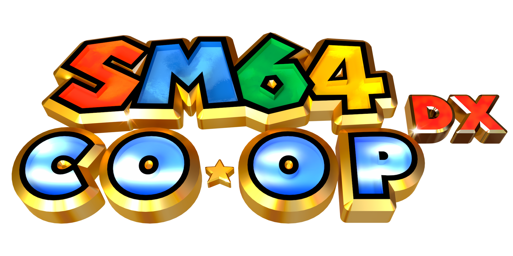

# sm64coopdx as a Discord Activity

This is a fork of [sm64coopdx](https://github.com/coop-deluxe/sm64coopdx) that runs Super Mario 64
co-op in the browser, inside a Discord voice channel. The game is built to WebAssembly with
Emscripten, and a small relay server signs players in with Discord and passes their packets along.

> **Disclaimer.** This project is not affiliated with, endorsed by, or sponsored by Nintendo or
> Discord. Super Mario 64 is © Nintendo. You need your own legally obtained copy of the game; this
> repository contains no ROM and no extracted game assets. See [`NOTICE`](NOTICE) for credits and
> licensing.

## Playing

1. In a voice channel, open the Activities menu and start the activity. It runs on desktop Discord.
2. By default, the page asks for your own **US Super Mario 64 ROM** (`.z64`). It is kept in
   your browser's storage and never uploaded; the server never sees it. If the relay operator has
   enabled hosted delivery, authorized clients download the configured copy automatically instead.
3. Everyone in the same Discord server plays in one world and shares one save. The first player in
   hosts, the rest join them. If the host leaves, everyone else rejoins on their own after a few
   seconds, and whoever is back first hosts the next session from the last saved state.

In hosted mode, clients receive the ROM bytes. Discord membership and the operator's guild allowlist
are access controls, not DRM and not a redistribution license; operators are responsible for the
rights and terms applicable to the copy they configure.

> **Operators:** hosted-ROM mode (`SM64_ROM_PATH`) serves the ROM file to every member of the allowed
> Discord servers (`DISCORD_GUILD_IDS`). Distributing it is your legal responsibility; leave it unset
> unless you are sure you may share that copy with those people.

## Building, testing, deploying

| | |
| --- | --- |
| [`web/README.md`](web/README.md) | the browser build: `make -j TARGET_WEB=1 web-dist` with emsdk, what differs from desktop, debug builds |
| [`server/README.md`](server/README.md) | `sm64-relay`: building it, sign-in flow, LAN test mode, and the tests |
| [`deploy/README.md`](deploy/README.md) | installing a release: `deploy/deploy.sh`, systemd units, example Cloudflare tunnel, Caddy and nginx configs, Discord Developer Portal settings |

In short:

```sh
source ~/emsdk/emsdk_env.sh                             # emsdk 6.0.12, the version CI uses
make -j TARGET_WEB=1 web-dist                           # -> build/us_web/dist
cmake -S server -B server/build -DCMAKE_BUILD_TYPE=Release && cmake --build server/build -j
server/build/sm64-relay --www build/us_web/dist --allow-lan-test
# then open http://localhost:8080/?room=test&name=Mario in two windows
```

The relay build and hosted-ROM source-only tests do not need game data. Full browser gameplay tests in
`server/README.md` require a user-owned `baserom.us.z64` (ignored by git); no ROM is part of this
implementation or its synthetic fixtures. CI (`.github/workflows/web-and-relay.yaml`) builds both and
runs the relay API and hosted-ROM source-only tests on every push and pull request to `main`.

The desktop build from upstream still works as before (`make`); see the
[upstream wiki](https://github.com/coop-deluxe/sm64coopdx/wiki) for its requirements.

## Self-hosting quickstart

You need a Linux machine, a domain name, and a Discord account. The details are in
[`deploy/README.md`](deploy/README.md).

1. **Discord application.** In the [Developer Portal](https://discord.com/developers/applications),
   create an application, then:
   - **OAuth2**: copy the client ID and client secret, and add a redirect URI (any, e.g.
     `https://127.0.0.1`; the Embedded App SDK needs one to exist).
   - **Activities → URL Mappings**: map `/` to your host name (e.g. `sm64.example.com`).
   - **Activities → Settings**: enable Activities (desktop). Keep the app private and add testers
     under **App Testers** while you try it out.
2. **Toolchain.** Install [emsdk](https://emscripten.org/docs/getting_started/downloads.html) at the
   version CI uses, plus the relay's dependencies:
   ```sh
   git clone https://github.com/emscripten-core/emsdk ~/emsdk
   ~/emsdk/emsdk install 6.0.12 && ~/emsdk/emsdk activate 6.0.12
   sudo apt install -y git make cmake g++ libboost-dev libssl-dev python3
   ```
3. **Configuration.** Copy `deploy/sm64-relay.env.example` to the relay's env file (mode `600`) and
   set `DISCORD_CLIENT_ID` and `DISCORD_CLIENT_SECRET`. `SM64_ROM_PATH` and `DISCORD_GUILD_IDS` (a
   comma-separated list of numeric Discord server IDs) are only for hosted-ROM mode, see the warning
   above; without them each player supplies their own ROM.
4. **Build and run.** `deploy/deploy.sh` builds the web release (`make TARGET_WEB=1 web-dist`, with
   emsdk sourced) and the relay, installs them under `~/sm64` (or `$PREFIX`), and restarts the
   systemd unit. Example units are in `deploy/examples/`.
5. **Public HTTPS.** Discord only loads Activities over HTTPS, so expose the relay (port 8080) through
   a Cloudflare tunnel, or put Caddy or nginx with a certificate in front of it. Both are described
   in `deploy/README.md`. If you use Cloudflare, no cache rules are needed: every asset URL carries
   a per-release `?v=` version, so browsers never mix old and new files.

Then start the Activity from a voice channel in a server where your app is installed.

## Credits

sm64coopdx is made by the Coop Deluxe Team, continuing
[sm64ex-coop](https://github.com/djoslin0/sm64ex-coop) by djoslin0, and builds on the
Super Mario 64 decompilation and PC port projects. All of the game, networking and Lua modding
work is theirs; this fork adds the browser build, the relay and the Discord integration. Please
report bugs in the browser or Discord parts here rather than upstream.

- Upstream: https://github.com/coop-deluxe/sm64coopdx
- Lua modding docs: [docs/lua/lua.md](docs/lua/lua.md), C docs: [docs/c/c.md](docs/c/c.md)
- sm64coopdx community Discord: https://discord.gg/TJVKHS4

You need your own legally obtained copy of the game to play. See [`NOTICE`](NOTICE) for the
licensing status of the code.
